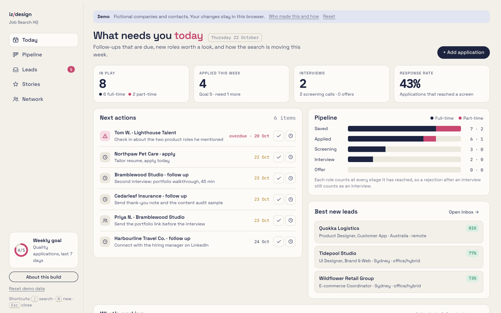
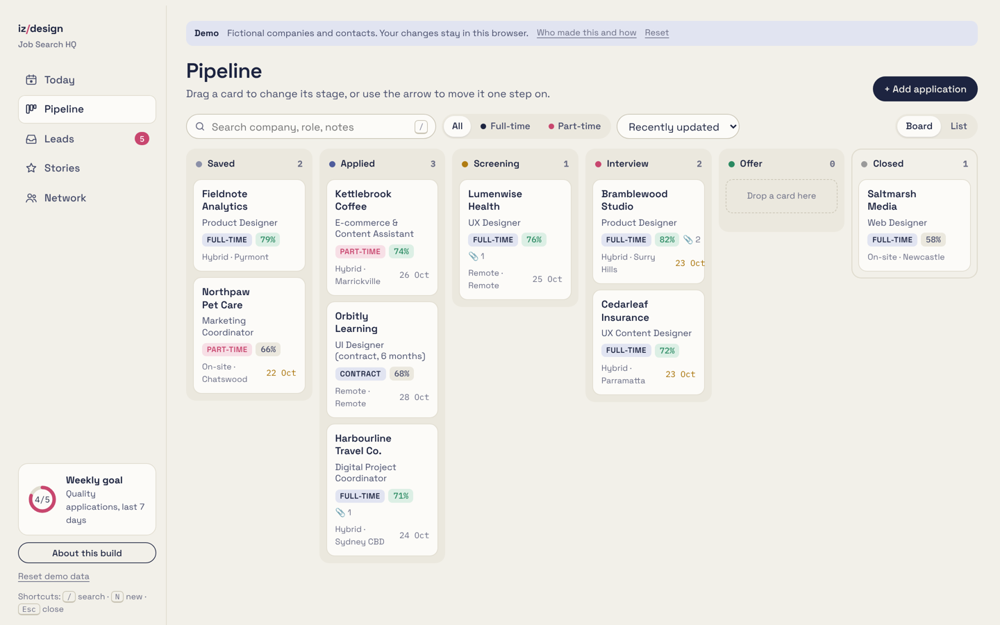
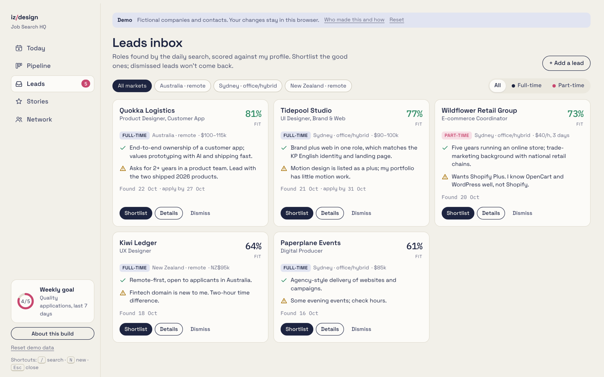
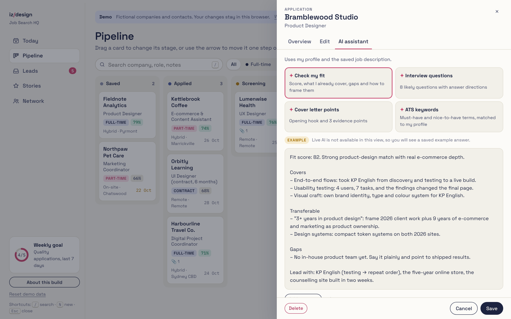
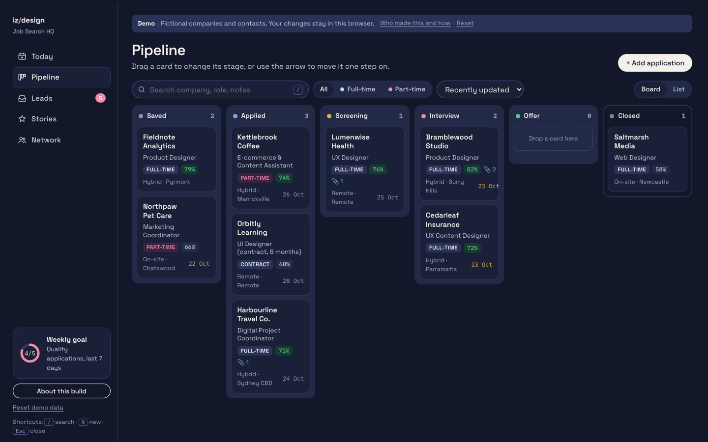
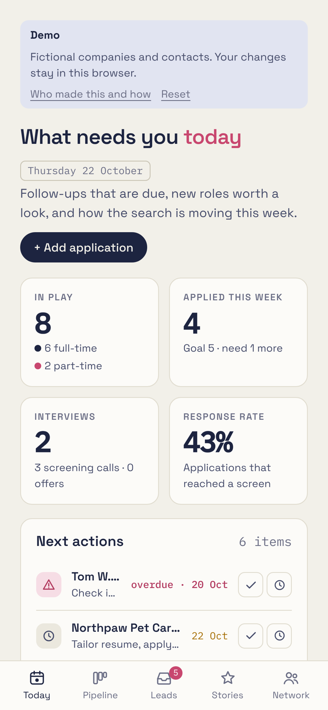

# Job Search HQ

A small web app I built to run my own job search, with an AI assistant inside. This repository holds the English demo with fictional data.

**Live demo:** _link added after deploy_ · **Designer:** Iryna Zakharenko, Sydney · [Portfolio](https://irynazakharenko.netlify.app)

## The problem

Vacancies, resumes, cover letters, follow-ups and interview notes were spread across job boards, email and folders. I kept losing track of who I had applied to, when to follow up, and which kinds of roles were actually answering.

## What it does

- **Today** answers "what do I do next?": due follow-ups with one-click Done and Snooze, the weekly goal, the pipeline, the best new leads, and which role types get replies.
- **Pipeline** is a board: drag a card to the next stage, use the arrow, or the ⋯ menu (keyboard friendly). Every move can be undone, and cards glide to their new column so the change is easy to follow.
- **Leads inbox** shows roles found by a daily search, each with a fit score, why it fits and the honest risk. Shortlist or dismiss, both with Undo; duplicates are caught.
- **AI assistant** on every saved role: fit check, likely interview questions, cover-letter points and ATS keywords, built from my profile and the saved job ad. Inside Claude it runs live; elsewhere the demo shows saved example answers.
- **STAR stories** and **Network** (people and recruitment agencies) with last contact and next step.

| Pipeline | Leads inbox |
|---|---|
|  |  |

| AI assistant | Dark mode | Phone |
|---|---|---|
|  |  |  |

## How I built it with AI

1. **Brief like a product spec.** The problem, the records (applications, leads, stories, people), every screen and its empty, loading and error states.
2. **Direct, don't type.** Claude (in Cowork) wrote the code. I reviewed each version on desktop and phone and sent precise change requests.
3. **Audit and iterate.** Version 2 came from my own UX audit of version 1: from a form-first tool to an action-first one.
4. **Check quality like a product team.** Nielsen's heuristics review and an automated WCAG 2.2 AA audit (axe-core) in light and dark themes at 1440, 640, 390 and 320 px.

## Design decisions

| Before (v1) | After (v2) | Why |
|---|---|---|
| Long list, status in a dropdown | Board with drag, arrow and ⋯ menu | Moving a role forward is the most frequent action |
| No way back from a mistake | Undo on every move, shortlist and dismiss | Speed without fear |
| Full-time and part-time as separate tabs | One filter | Removed duplicated stats and navigation |
| One long edit form | Tabs: Overview · Edit · AI assistant | Read first, edit when needed |
| Stage saved only with the form | Stage saves instantly with Undo; unsaved form changes are marked | One clear saving model |

## Accessibility and adaptability

- WCAG 2.2 AA: 0 axe-core violations across all views, both themes and four widths.
- Text contrast of at least 4.5:1, visible focus everywhere, focus kept inside the open panel, Esc to close.
- Drag and drop has a keyboard and touch alternative (the ⋯ menu); status is never shown by colour alone.
- Type in `rem`, so the browser's text-size setting is respected; 7 type sizes, spacing on a 4 px grid, 4 radius tokens.
- Respects reduced-motion settings; works from 320 px wide to desktop and at 200% zoom.

## Tech

One self-contained `index.html`: HTML, CSS and vanilla JavaScript, no build step. Demo data lives in your browser's local storage; **Reset demo data** restores it.

## Roadmap

1. Paste a job link or description and let AI fill in the card.
2. Sync between devices.
3. Weekly review: what worked, by role type and source.

My working version (in Ukrainian, with my real data) has run my search since October 2026.
